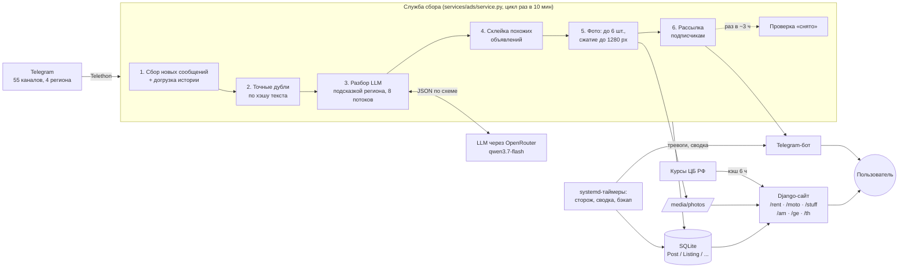
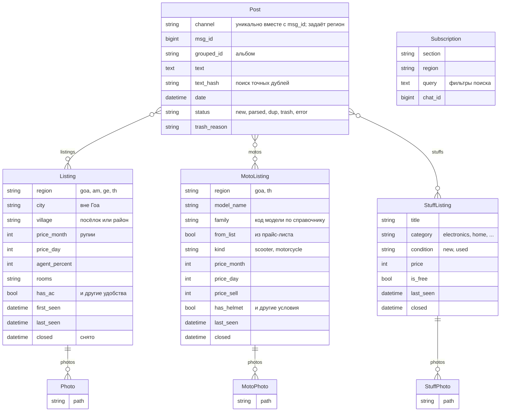

# Goads — агрегатор объявлений из Telegram: Гоа, Армения, Грузия, Пхукет

**Сайт: [goadoska.ru](https://goadoska.ru)**

> **In English.** Goads collects rental and classified ads (housing, bikes, second-hand items) from 55 Telegram
> channels and groups in four regions: Goa (India), Armenia, Georgia and Phuket (Thailand). ~1,150 free-form messages
> a day are deduplicated, parsed by an LLM into structured fields (~$0.0002 per message), merged when they describe
> the same offer, checked for "rented/sold", and served on a Django site with search, filters, prices in local and common
> currencies and a Telegram bot for saved searches. Runs unattended on a $5 VPS with watchdog alerts and nightly backups.
> Role: problem framing, requirements, architecture decisions and acceptance — author; code written with Claude Code.

## Проблема

Русскоязычные в Гоа, Армении, Грузии и на Пхукете ищут жильё, байки и вещи через Telegram. Объявления разбросаны
по десяткам каналов, написаны в свободной форме («2bhk Морджим 45к, кондей, вайфай»), повторяются в разных каналах,
тонут в ленте за пару дней, а сданное никто не убирает. По ним нельзя искать и нельзя сравнивать:
«покажи 1-комнатные в Арамболе до 40 000 ₹ с кондиционером» — такой запрос в Telegram не сделать.

## Проект в цифрах

Срез на 19.10.2026, средние за неделю. Подробно — [проект в цифрах](docs/06-metrics.md).

| | |
|---|---|
| **Регионы** | 4 страны: Гоа (жильё, байки, барахолка), Армения и Грузия (жильё), Пхукет (жильё, байки) |
| **Источники** | 55 открытых Telegram-каналов и групп: Гоа 34, Армения 7, Грузия 5, Пхукет 9 |
| **Поток** | ~1 150 сообщений в сутки; 21 % становятся объявлениями, 33 % — дубли, 42 % — мусор |
| **Новых объявлений** | ~210 в сутки: жильё ~180 (Армения 63, Грузия 54, Гоа 46, Пхукет 17), байки ~16, вещи ~13 |
| **Актуальных объявлений** | ~3 100; 46 % карточек жилья собраны из нескольких сообщений разных каналов |
| **Разбор LLM** | `qwen3.7-flash` через OpenRouter: ≈ $0,0002 за сообщение, $1,78 за октябрь, ~$4–5 в месяц |
| **Инфраструктура** | Один VPS за $5 в месяц (2 ГБ RAM, занято ~620 МБ); всего ≈ $10 в месяц |
| **Свежесть** | Новое объявление — на сайте в течение ~10 минут; снятое пропадает в течение ~3 часов |
| **Качество** | Модель выбрана на эталоне: 11 из 12 сообщений разобраны верно; проверка «снято» — 32 из 32 верно |

## Что делает Goads

- **Сбор** новых сообщений из 55 каналов четырёх регионов с продолжением с последнего сообщения;
  для новых регионов — догрузка истории за 2 недели.
- **Отсев точных дублей** по хэшу нормализованного текста (без ссылок, ников и телефонов) — без обращения к LLM.
- **Разбор текста LLM** подсказкой своего региона: место (посёлок или город + район), цена и её валюта, комнаты,
  удобства, модель байка, категория вещи. Цены переводятся в рупии. Реклама, вопросы, «ищу», обмен валют,
  продажа недвижимости помечаются мусором с причиной.
- **Склейка похожих объявлений**: одно и то же предложение из разных каналов становится одной карточкой.
- **Прайс-листы** («Fascino 7000, Aerox 14000») — отдельная карточка на каждую позицию.
- **Справочник байков**: 41 модель — фильтр по модели, картинка модели, отсев машин.
- **«Снято»**: каждые ~3 часа исходные сообщения перечитываются; удалённое или с пометкой «сдано / sold» пропадает с сайта.
- **Сайт** с поиском, фильтрами (город → район, комнаты, удобства, цена, период), карточкой со ссылками на все
  исходные сообщения и фото, отметкой «Просмотрено».
- **Валюты**: местная (₹ ֏ ₾ ฿) по умолчанию и общие ₽ $ Б ₴ по курсу ЦБ РФ.
- **Telegram-бот** [@Goadoskabot](https://t.me/Goadoskabot): «Подписаться на этот поиск» — новые объявления под фильтр приходят в Telegram.
- **Сопровождение без человека**: сторож и тревоги владельцу в Telegram, утренняя сводка, ночные резервные копии.
- **SEO**: robots.txt, sitemap.xml, заголовки и превью; сайт подтверждён в Яндекс.Вебмастере и Google Search Console.

## Документация аналитика

Артефакты системного анализа по проекту — в папке [docs/](docs/README.md):

- [Спецификация требований](docs/01-requirements.md) — проблема, пользователи, регионы, FR/NFR, бизнес-правила
- [Архитектура C4 (уровни 1–2)](docs/02-architecture-c4.md) — контекст системы и контейнеры
- [Цикл сбора (sequence)](docs/03-collection-sequence.md) — путь сообщения от канала до карточки, обработка сбоев
- [Модель данных (ER)](docs/04-data-model.md) — таблицы, связи «многие-ко-многим», регионы, подписки
- [Состояния сообщения](docs/05-post-states.md) — жизненный цикл и причины отсева в мусор
- [Проект в цифрах](docs/06-metrics.md) — каналы, поток, объявления по регионам, расходы
- [Журнал решений (ADR)](docs/adr/README.md) — SQLite, LLM вместо правил, отдельный VPS, отсев дешёвого «жилья»,
  регионы настройкой, «снято», мониторинг через Telegram

## Скриншоты

<!-- Скриншоты: положите файлы в docs/screenshots/ с этими именами -->
| Поиск жилья | Карточка объявления | Байки |
|---|---|---|
|  |  |  |

## Архитектура



Подробно: [C4, уровни 1–2](docs/02-architecture-c4.md) и [цикл сбора](docs/03-collection-sequence.md).

## Модель данных

Подробно: [ER-модель с полями и ключами](docs/04-data-model.md).

`Post` — сырое сообщение из канала, объявления (`Listing`, `MotoListing`, `StuffListing`) — результат разбора.
Связь многие-ко-многим: одно объявление собирается из нескольких сообщений (дубли в разных каналах),
а одно сообщение-прайс-лист («Fascino 7000, Aerox 14000») даёт несколько объявлений.
Регион — поле `region`, а не отдельная база; снятое объявление не удаляется, а получает дату `closed`.



## Ключевые решения

Развёрнутые записи с вариантами и последствиями — в [журнале решений (ADR)](docs/adr/README.md).

| Решение | Почему |
|---|---|
| **LLM вместо правил и регулярных выражений** | Тексты в свободной форме, смесь русского и английского, сленг («2бхк», «кондей», «45к») — правилами такое не покрыть. Новая страна — новая подсказка, а не новый парсер. |
| **Модель выбрана на эталонном наборе** | Модели сравнивались на 12 сообщениях с заранее известным правильным разбором: `qwen3.7-flash` — 11 из 12, `deepseek-v4-flash` — 10 из 12. Модель меняется одной настройкой `LLM_MODEL`. |
| **Стоимость под контролем** | Треть потока — точные дубли, они отсеиваются до LLM; старые сообщения не разбираются. ≈ $0,0002 за сообщение, месячный лимит на ключе, тревога при остатке < $1. |
| **Регионы — настройкой, а не копией сайта** | Одна служба сбора, одна база, одна Telegram-сессия; регион = файл каналов + подсказка GPT + несколько записей настроек. Армения, Грузия и Пхукет запущены за три дня. |
| **Сообщение ↔ объявления — многие-ко-многим** | Прайс-лист прокатчика байков — одно сообщение и 5–10 разных предложений; одно предложение публикуется в нескольких каналах. Связь 1:1 теряла либо данные, либо карточки дублировались. |
| **Склейка похожих, а не только точных дублей** | Одно объявление в разных каналах отличается парой слов. Склеиваются записи с тем же регионом, местом, ценой и комнатами и текстом, совпадающим на 75 % и больше. |
| **Цены хранятся в рупиях** | Одна валюта в базе — один фильтр и одна сортировка; цена из драм, лари, батов, $ переводится при разборе, в выбранную валюту — при показе, по курсу ЦБ с кэшем и запасными курсами. |
| **«Снято» по действиям автора** | Удалил сообщение или дописал «сдано / sold» — объявление скрывается; слово, которое было в тексте изначально, не считается. |
| **Мониторинг через своего бота** | Prometheus/Grafana избыточны для одного сервера; сторож на systemd-таймере проверяет именно то, что ломается молча: сбор, деньги на GPT, сессию Telegram. |
| **SQLite, а не PostgreSQL** | Пишет один процесс; база — один файл (28 МБ). Поиск без регистра по-русски решён своей функцией `py_lower`. |
| **Нет «ads» в адресах** | Блокировщики рекламы режут адреса с `/ads/` — раздел жилья живёт на `/rent/`, фото в `media/photos/`. |

## Стек

- Python 3.12, Django 6, SQLite
- Telethon (Telegram API), Telegram Bot API (webhook)
- LLM через OpenRouter (API, совместимый с OpenAI), ответы в JSON
- Pillow (обработка фото), loguru (журналы)
- HTML/CSS/JS без фреймворков на фронте
- Ubuntu 24.04, nginx, Gunicorn, systemd (службы и таймеры), Let's Encrypt, ufw

## Как запустить локально

Нужны Python 3.12, API-ключи Telegram ([my.telegram.org](https://my.telegram.org)) и ключ OpenRouter.

```bash
python -m venv venv
venv/Scripts/pip install -r requirements.txt   # Linux/macOS: venv/bin/pip
cp .env.example .env                           # заполнить ключи
venv/Scripts/python manage.py migrate
venv/Scripts/python manage.py createsuperuser
```

Один цикл сбора (при первом запуске Telethon попросит телефон и код из Telegram):

```bash
venv/Scripts/python services/ads/service.py --once --limit 50
```

Сайт — http://localhost:8000:

```bash
venv/Scripts/python manage.py runserver
```

Сервис в постоянном режиме: `services/ads/service.py` без флагов (цикл раз в 10 минут).
Сводка, как её получает владелец, без отправки: `manage.py monitor print`.

## Структура

```
ads/        жильё: Post, Listing, Photo, Subscription; регионы, районы, валюты, SEO,
            бот (bot.py), мониторинг и сводка (monitor.py, visits.py); страницы /rent/, /am/, /ge/, /th/
moto/       байки: MotoListing, MotoPhoto, справочник моделей (catalog.py) и характеристик
stuff/      барахолка: StuffListing, StuffPhoto
services/   служба сбора и разбора, LLM-клиент и подсказки регионов, списки каналов
deploy/     резервные копии, таймеры сторожа и сводки (systemd)
goads/      настройки Django
static/     стили, общий JS списков, картинки регионов и моделей байков
docs/       документация аналитика
```

## Планы

- **Свои фильтры на страну**: по объявлениям каждого региона понять, какие удобства реально упоминают;
  убрать «посуточно» там, где посуточных объявлений нет.
- **Барахолки других стран** — только с проверкой на скрытую рекламу запрещённого (отдельная проверка GPT,
  стоп-слова, ручная проверка подозрительного).
- **Новые источники**: каналы Батуми, байки Пхукета.
- **Внешний мониторинг доступности** — сторож не заметит падение всего сервера.
- **Срок хранения фото** снятых и старых объявлений — диск растёт с каждым объявлением.
- Открыть страницы новых регионов для поисковиков после MVP.

## Роль

Постановка задач, требования, архитектурные решения и проверка — автор; код написан с помощью Claude Code.
