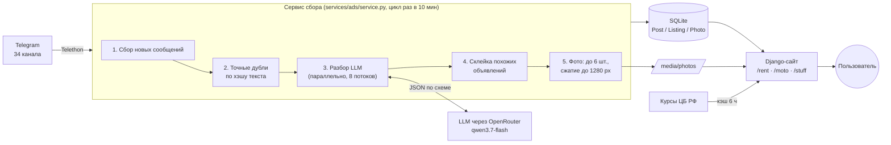
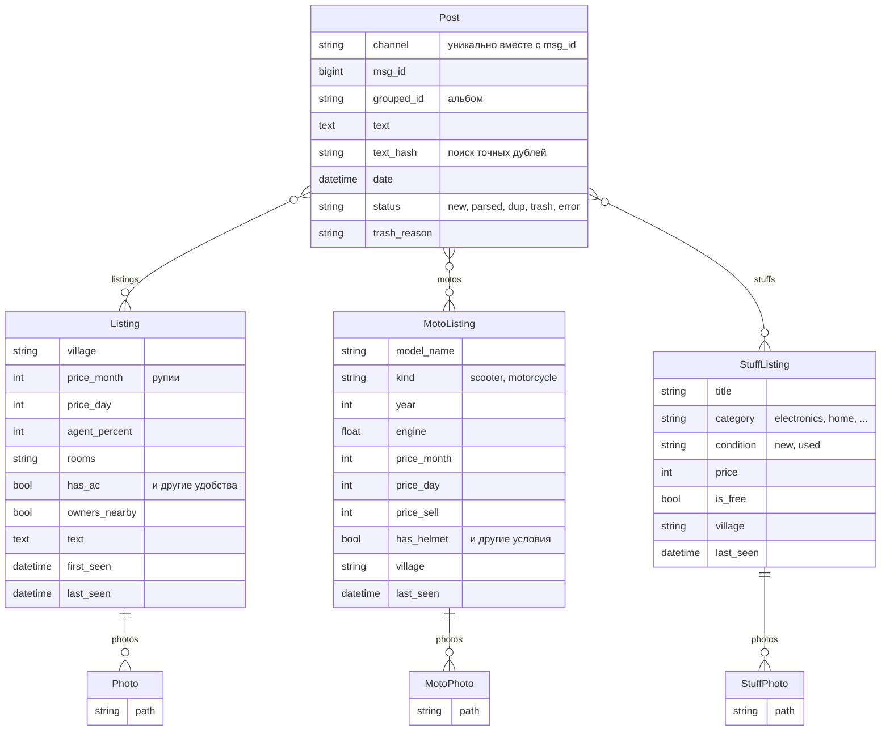

# Goads — агрегатор объявлений Гоа из Telegram

**Сайт: [goadoska.ru](https://goadoska.ru)** · Live: [goadoska.ru](https://goadoska.ru)

> **In English.** Goads collects rental and classified ads (housing, bikes, second-hand items) from 34 Telegram
> channels in Goa, India. Free-form messages are deduplicated, parsed by an LLM into structured fields, merged
> when they describe the same offer, and served on a Django site with search, filters and prices in 5 currencies.
> Role: problem framing, requirements, architecture decisions and acceptance — author; code written with Claude Code.

## Проблема

Русскоязычные в Гоа ищут жильё, байки и вещи через Telegram. Объявления разбросаны по десяткам каналов,
написаны в свободной форме («2bhk Морджим 45к, кондей, вайфай»), повторяются в разных каналах и тонут
в ленте за пару дней. По ним нельзя искать и нельзя сравнивать: «покажи 1-комнатные в Арамболе до 40 000 ₹
с кондиционером» — такой запрос в Telegram не сделать.

## Что делает Goads

- **Сбор** новых сообщений из 34 каналов (жильё, байки, барахолка) с продолжением с последнего сообщения.
- **Отсев точных дублей** по хэшу нормализованного текста (без ссылок, ников и телефонов) — без обращения к LLM.
- **Разбор текста LLM** в структурированные поля: посёлок, цена за месяц/сутки, комнаты, удобства,
  модель байка, категория вещи и т. д. Нерелевантное (реклама, вопросы, «ищу») помечается мусором.
- **Склейка похожих объявлений**: одно и то же предложение из разных каналов становится одной карточкой.
- **Сайт** с поиском, фильтрами и карточкой объявления со ссылкой на исходное сообщение и фото.
- **Цены в 5 валютах** (₽, Br, ₴, $, ₹) по курсу ЦБ РФ, в базе хранятся в рупиях.

## Документация аналитика

Артефакты системного анализа по проекту — в папке [docs/](docs/README.md):

- [Спецификация требований](docs/01-requirements.md) — проблема, пользователи, FR/NFR, бизнес-правила
- [Архитектура C4 (уровни 1–2)](docs/02-architecture-c4.md) — контекст системы и контейнеры
- [Цикл сбора (sequence)](docs/03-collection-sequence.md) — путь сообщения от канала до карточки, обработка сбоев
- [Модель данных (ER)](docs/04-data-model.md) — таблицы, связи «многие-ко-многим», справочник
- [Состояния сообщения](docs/05-post-states.md) — жизненный цикл и причины отсева в мусор
- [Журнал решений (ADR)](docs/adr/README.md) — SQLite, LLM вместо правил, отдельный VPS, отсев дешёвого «жилья»

## Скриншоты

<!-- Скриншоты: положите файлы в docs/screenshots/ с этими именами -->
| Поиск жилья | Карточка объявления | Байки |
|---|---|---|
|  |  |  |

## Архитектура



Подробно: [C4, уровни 1–2](docs/02-architecture-c4.md) и [цикл сбора](docs/03-collection-sequence.md).

## Модель данных

Подробно: [ER-модель с полями и ключами](docs/04-data-model.md).

`Post` — сырое сообщение из канала, объявления (`Listing`, `MotoListing`, `StuffListing`) — результат разбора.
Связь многие-ко-многим: одно объявление собирается из нескольких сообщений (дубли в разных каналах),
а одно сообщение-прайс-лист («Fascino 7000, Aerox 14000») даёт несколько объявлений.



## Ключевые решения

Развёрнутые записи с вариантами и последствиями — в [журнале решений (ADR)](docs/adr/README.md).

| Решение | Почему |
|---|---|
| **LLM вместо правил и регулярных выражений** | Тексты в свободной форме, смесь русского и английского, сленг («2бхк», «кондей», «45к») — правилами такое не покрыть. |
| **Модель выбрана на эталонном наборе** | Модели сравнивались на эталонном наборе из 12 сообщений с заранее известным правильным разбором: `qwen3.7-flash` разобрала верно 11 из 12, `deepseek-v4-flash` — 10 из 12; выбрана первая. Модель меняется одной настройкой `LLM_MODEL`. |
| **Стоимость под контролем** | Неделя сообщений (~3000) разобрана за **$0.32** (~$0.0001 за сообщение). Точные дубли отсеиваются до LLM, сообщения старше 7 дней не разбираются. |
| **Сообщение ↔ объявления — многие-ко-многим** | Прайс-лист прокатчика байков — это одно сообщение и 5–10 разных предложений; одно предложение публикуется в нескольких каналах. Связь 1:1 теряла либо данные, либо карточки дублировались. |
| **Склейка похожих, а не только точных дублей** | Одно объявление в разных каналах отличается парой слов. Склеиваются записи с тем же посёлком, ценой и комнатами и текстом, совпадающим на 75 % и больше. |
| **Цены хранятся в рупиях** | Источник цены всегда в ₹; конвертация только при показе по курсу ЦБ с кэшем и запасными курсами, если ЦБ недоступен. |
| **Один сервис вместо четырёх скриптов** | Раньше парсер текста, парсер фото, LLM-разбор и загрузка фото запускались отдельно и расходились по состоянию. Сейчас один цикл с блокировкой от повторного запуска. |
| **Нет «ads» в адресах** | Блокировщики рекламы режут адреса с `/ads/` — раздел жилья живёт на `/rent/`. |

## Стек

- Python 3.12, Django 6, SQLite
- Telethon (Telegram API)
- LLM через OpenRouter (API, совместимый с OpenAI), ответы в JSON
- Pillow (обработка фото), loguru (журналы)
- HTML/CSS/JS без фреймворков на фронте

## Как запустить локально

Нужны Python 3.12, API-ключи Telegram ([my.telegram.org](https://my.telegram.org)) и ключ OpenRouter.

```bash
python -m venv venv
venv/Scripts/pip install -r requirements.txt   # Linux/macOS: venv/bin/pip
cp .env.example .env                           # заполнить ключи
venv/Scripts/python manage.py migrate
venv/Scripts/python manage.py createsuperuser
```

Один цикл сбора (при первом запуске Telethon попросит телефон и код из Telegram):

```bash
venv/Scripts/python services/ads/service.py --once --limit 50
```

Сайт — http://localhost:8000:

```bash
venv/Scripts/python manage.py runserver
```

Сервис в постоянном режиме: `services/ads/service.py` без флагов (цикл раз в 10 минут).

## Структура

```
ads/        жильё: модели Post, Listing, Photo; курсы валют; страницы /rent/
moto/       байки: MotoListing, MotoPhoto, справочник характеристик моделей
stuff/      барахолка: StuffListing, StuffPhoto
services/   сервис сбора и разбора, LLM-клиент, списки каналов
goads/      настройки Django
static/     стили и общий JS списков
```

## Планы

- **Выкладка**: Gunicorn + nginx, сервис сбора как системная служба, отдельный VPS.
- **PostgreSQL**: в SQLite поиск без учёта регистра работает только для латиницы («Коляска» ≠ «коляска»).
- **Мультирегиональность**: те же каналы-источники есть у Бали, Пхукета, Нячанга — регион как сущность
  в модели данных и списки каналов по регионам.
- Скрывать неактуальные объявления (не появлялись 2–3 недели), сводка по сбору в Telegram.

## Роль

Постановка задач, требования, архитектурные решения и проверка — автор; код написан с помощью Claude Code.
