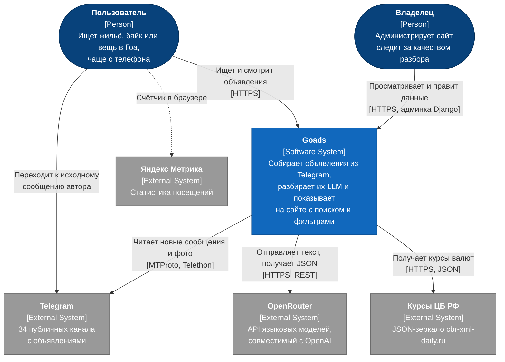
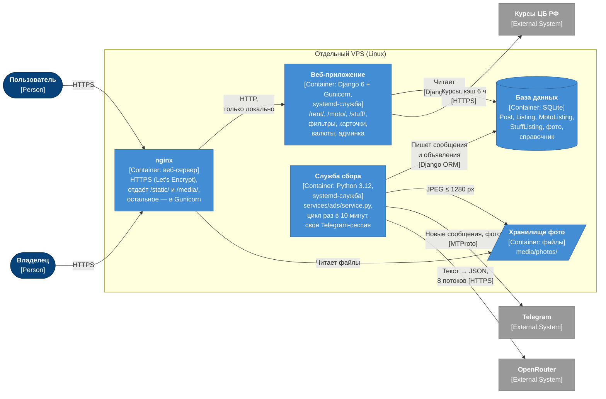

# Архитектура: модель C4, уровни 1–2

> Источники: `services/ads/service.py`, `services/ads/llm.py`, `ads/currency.py`, `goads/settings.py`,
> `goads/urls.py`, `ads/templates/metrika.html`.
> Диаграммы нарисованы блок-схемами Mermaid в нотации C4 (тип элемента — в квадратных скобках):
> встроенный в Mermaid тип `C4Context` на GitHub пока отображается нестабильно.

## Уровень 1. Контекст системы

Кто пользуется системой и с какими внешними системами она связана.

## Уровень 2. Контейнеры

Из чего состоит Goads на сервере и как части обмениваются данными.

## Пояснения к контейнерам

| Контейнер | Технология | Ответственность | Ключевые настройки |
|---|---|---|---|
| nginx | nginx | Завершает HTTPS, отдаёт статику и фото, проксирует остальное в Gunicorn | Сертификат Let's Encrypt, автопродление |
| Веб-приложение | Django 6, Gunicorn | Списки с фильтрами и сортировкой, карточки, перевод цен в валюты, вход (по настройке), админка | `SITE_HTTPS`, `SITE_LOGIN_REQUIRED`, `ALLOWED_HOSTS` |
| Служба сбора | Python 3.12, Telethon, Pillow | Сбор → дубли → разбор LLM → отсев мусора → склейка → фото ([подробно](03-collection-sequence.md)) | `INTERVAL_MIN = 10`, `LLM_WORKERS = 8`, `MAX_AGE_DAYS = 7`, `LLM_MODEL` |
| База данных | SQLite (один файл) | Сообщения, объявления трёх разделов, пути к фото, справочник байков ([модель](04-data-model.md)) | [ADR-0001](adr/0001-sqlite.md) |
| Хранилище фото | Папки на диске | До 6 JPEG на объявление; обложки видео — `v1.jpg`, `v2.jpg`… | Папка `photos`, а не `ads` — иначе режут блокировщики рекламы |

## Взаимодействие контейнеров

- Служба сбора и сайт **не вызывают друг друга**: общаются только через базу и папку фото.
  Сайт можно перезапускать, не останавливая сбор, и наоборот.
- В базу пишет **один процесс** — служба сбора; сайт только читает (кроме входа и админки).
  Это снимает главное ограничение SQLite — одну запись в момент времени.
- Второй экземпляр службы сбора не стартует (блокировка файла): одна Telegram-сессия в двух процессах
  ломает соединение.
- Курсы валют кэшируются на 6 часов; если ЦБ недоступен — запасные курсы, повторная попытка через 10 минут.
- Почему сайт на отдельном сервере — [ADR-0003](adr/0003-separate-vps.md).
