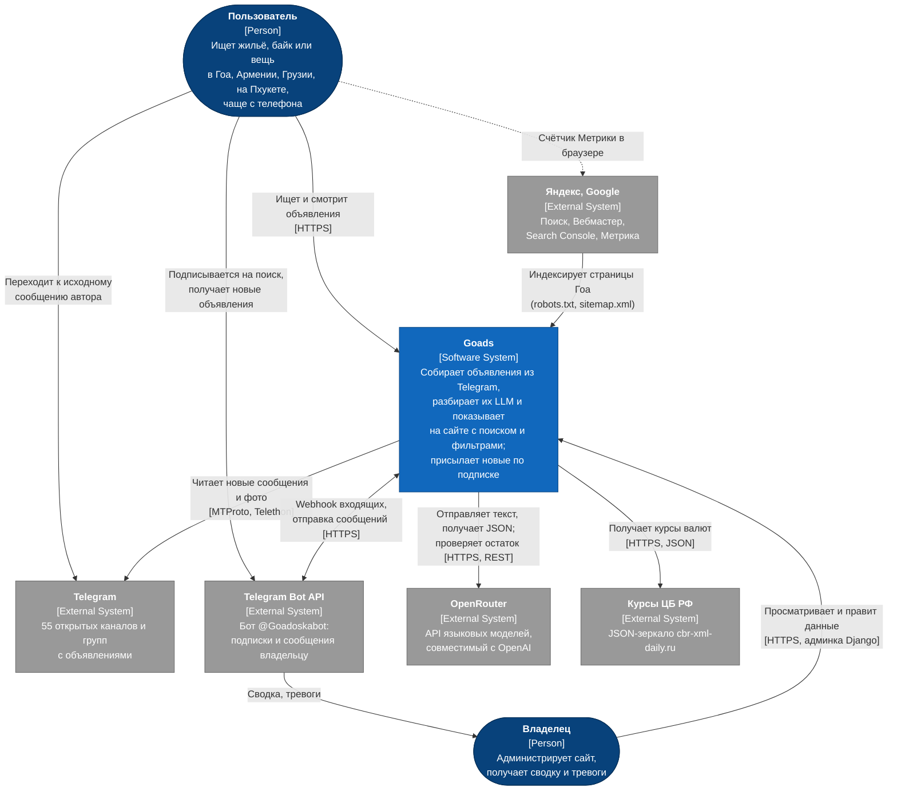
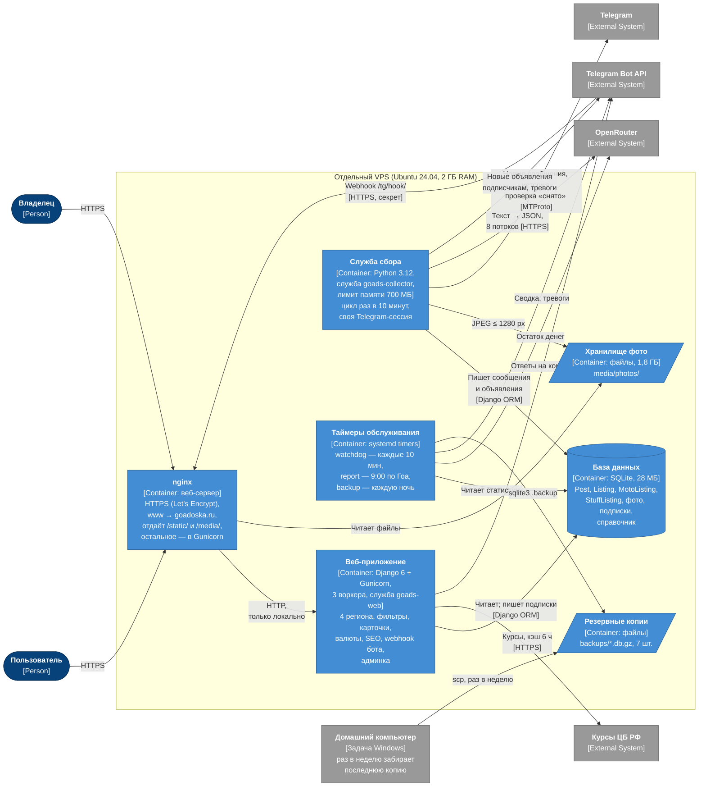

# Архитектура: модель C4, уровни 1–2

> Источники: `services/ads/service.py`, `services/ads/llm.py`, `ads/currency.py`, `ads/bot.py`, `ads/monitor.py`,
> `ads/visits.py`, `ads/seo.py`, `goads/settings.py`, `goads/urls.py`, `ads/templates/metrika.html`, `deploy/`.
> Диаграммы нарисованы блок-схемами Mermaid в нотации C4 (тип элемента — в квадратных скобках):
> встроенный в Mermaid тип `C4Context` на GitHub пока отображается нестабильно.

## Уровень 1. Контекст системы

Кто пользуется системой и с какими внешними системами она связана.

## Уровень 2. Контейнеры

Из чего состоит Goads на сервере и как части обмениваются данными.

## Пояснения к контейнерам

| Контейнер | Технология | Ответственность | Ключевые настройки |
|---|---|---|---|
| nginx | nginx | Завершает HTTPS, перенаправляет www, отдаёт статику и фото, проксирует остальное в Gunicorn; его журнал — источник подсчёта посетителей | Сертификат Let's Encrypt, автопродление `certbot.timer`; ufw: только ssh, 80, 443 |
| Веб-приложение | Django 6, Gunicorn | Списки с фильтрами и сортировкой по 4 регионам, карточки, перевод цен в валюты, SEO (robots, sitemap, превью), приём сообщений бота, вход (по настройке), админка | `SITE_HTTPS`, `SITE_LOGIN_REQUIRED`, `ALLOWED_HOSTS`, `YANDEX_METRIKA_ID`, `TG_BOT_*` |
| Служба сбора | Python 3.12, Telethon, Pillow | Сбор → догрузка истории → дубли → разбор LLM → отсев мусора → склейка → фото → рассылка бота → раз в ~3 ч проверка «снято» ([подробно](03-collection-sequence.md)) | `INTERVAL_MIN = 10`, `LLM_WORKERS = 8`, `MAX_AGE_DAYS = 7 / 14`, `LLM_MODEL`, `MemoryMax=700M` |
| Таймеры обслуживания | systemd timers + `manage.py monitor`, `deploy/backup_db.sh` | Сторож, утренняя сводка, ночная резервная копия ([ADR-0007](adr/0007-telegram-monitoring.md)) | `TG_ADMIN_CHAT_ID`, `STALE_MIN = 40`, `LOW_BALANCE_USD = 1` |
| База данных | SQLite (один файл) | Сообщения, объявления трёх разделов, пути к фото, подписки, справочник байков ([модель](04-data-model.md)) | [ADR-0001](adr/0001-sqlite.md) |
| Хранилище фото | Папки на диске | До 6 JPEG на объявление; обложки видео — `v1.jpg`, `v2.jpg`… | Папка `photos`, а не `ads` — иначе режут блокировщики рекламы |
| Резервные копии | gzip-файлы | Ночные копии базы с проверкой `integrity_check`, 7 последних + `latest.db.gz` | Восстановление: `gunzip` при остановленных службах |

## Взаимодействие контейнеров

- Служба сбора и сайт **не вызывают друг друга**: общаются только через базу и папку фото.
  Сайт можно перезапускать, не останавливая сбор, и наоборот.
- Объявления пишет **один процесс** — служба сбора; сайт пишет только подписки, вход и правки админки.
  Это снимает главное ограничение SQLite — одну запись в момент времени.
- Все четыре региона обслуживает **одна** служба сбора с одной Telegram-сессией ([ADR-0005](adr/0005-regions-as-config.md)).
  Второй экземпляр не стартует (блокировка файла): одна сессия в двух процессах ломает соединение.
- Рассылка подписчикам идёт из службы сбора сразу после цикла — по тем же функциям фильтрации (`build_queryset`),
  что и страницы сайта, поэтому бот и сайт показывают одно и то же.
- Курсы валют кэшируются на 6 часов; если ЦБ недоступен — запасные курсы, повторная попытка через 10 минут.
- Сборщик отмечает каждый завершённый цикл в `logs/heartbeat`; по нему сторож понимает, что сбор не завис.
- Почему сайт на отдельном сервере — [ADR-0003](adr/0003-separate-vps.md).
