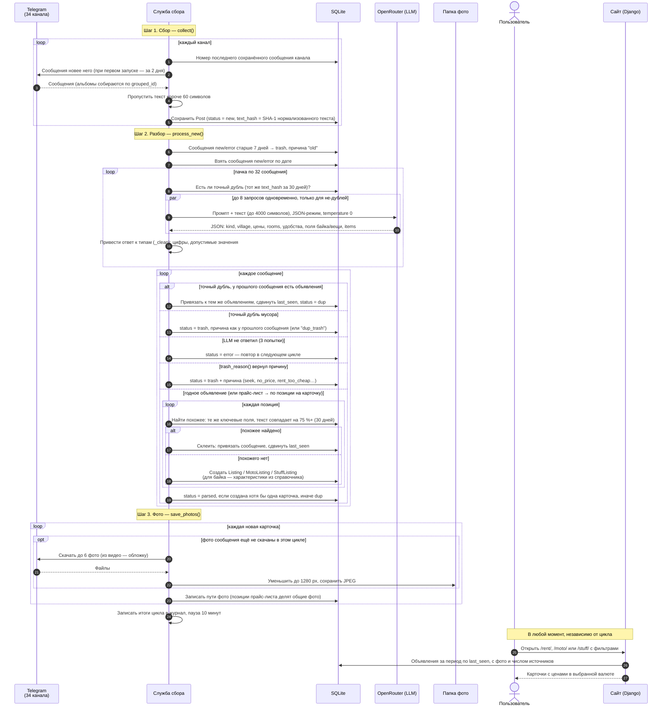

# Цикл сбора: sequence-диаграмма

> Источник: `services/ads/service.py` — функции `run_cycle`, `collect`, `process_new`,
> `prefetch_answers`, `find_exact_duplicate`, `trash_reason`, `find_similar_*`, `create_listing`, `save_photos`;
> `services/ads/llm.py` — `parse_ad`.

Служба сбора при старте один раз находит все 34 канала (`resolve_channels`), затем каждые 10 минут
выполняет цикл `run_cycle`: **сбор → разбор → фото**. Сайт в цикле не участвует — он читает уже готовые
объявления из базы.

## Обработка сбоев

| Ситуация | Поведение |
|---|---|
| Telegram просит подождать (FloodWait) | Служба ждёт указанное время, канал пропускается до следующего цикла |
| Канал недоступен или переименован | Ошибка в журнал, остальные каналы собираются |
| LLM вернул ошибку сети / 5xx | До 3 попыток с паузой 5, 10, 15 с; затем `status = error` и повтор в следующем цикле |
| LLM не поддерживает JSON-режим (HTTP 400) | Повтор без `response_format`, JSON просится текстом промпта |
| Неверный ключ или кончились деньги (HTTP 401/402/403) | Цикл прерывается, ошибка в журнал; неразобранные сообщения остаются `new`/`error` и разберутся после пополнения (если не устареют за 7 дней) |
| Фото не скачалось | Предупреждение в журнал, карточка остаётся без этого фото |
| Сообщение собрано в прошлом цикле, фото нет в памяти | Альбом запрашивается заново по номерам сообщений (`msg_id … msg_id + 9`) |
| Запущен второй экземпляр службы | Он видит блокировку `logs/service.lock` и сразу завершается |

## Почему так

- **Дубли отсекаются до LLM**: в базе дублей больше, чем разобранных объявлений — это прямая экономия денег
  ([ADR-0002](adr/0002-llm-instead-of-rules.md)).
- **Запросы к LLM — пачками и параллельно**: последовательный разбор недели сообщений занял бы часы.
- **Фото скачиваются только для новых карточек**: у дублей и мусора фото не нужны.
