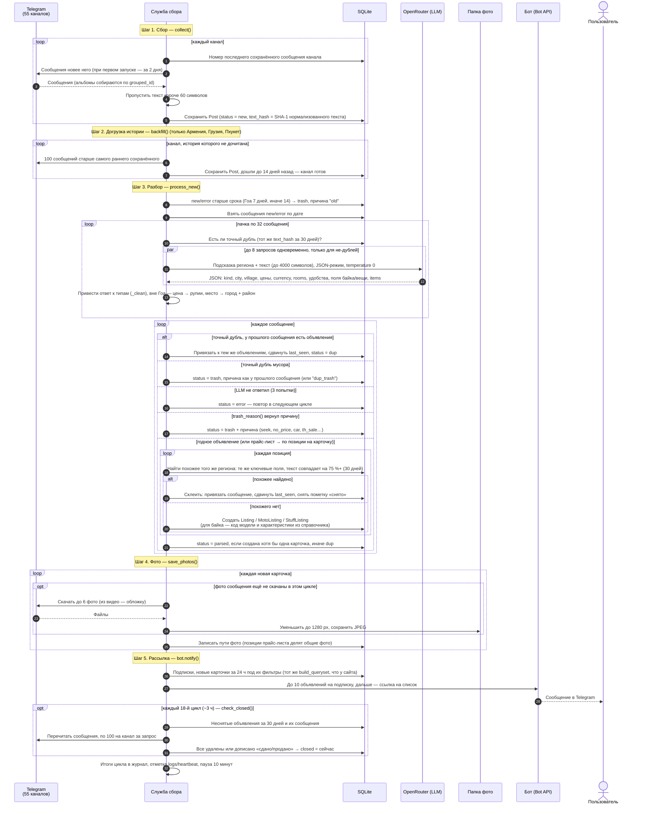

# Цикл сбора: sequence-диаграмма

> Источник: `services/ads/service.py` — функции `run_cycle`, `collect`, `backfill`, `process_new`,
> `prefetch_answers`, `ask_gpt`, `find_exact_duplicate`, `trash_reason`, `find_similar_*`, `create_listing`,
> `save_photos`, `check_closed`; `services/ads/llm.py` — `parse_ad`; `ads/bot.py` — `notify`; `ads/monitor.py`.

Служба сбора при старте один раз находит все 55 каналов четырёх регионов (`resolve_channels`), затем каждые
10 минут выполняет цикл `run_cycle`: **сбор → догрузка истории → разбор → фото → рассылка бота**, а каждый
18-й цикл (~3 часа) ещё и **проверку «снято»**. Сайт в цикле не участвует — он читает уже готовые объявления из базы.

## Обработка сбоев

| Ситуация | Поведение | Владелец узнаёт |
|---|---|---|
| Telegram просит подождать (FloodWait) | Служба ждёт указанное время, канал пропускается до следующего цикла | — |
| Канал недоступен или переименован | Ошибка в журнал, остальные каналы собираются | — (видно в журнале: «Каналов доступно: N из 55») |
| LLM вернул ошибку сети / 5xx | До 3 попыток с паузой 5, 10, 15 с; затем `status = error` и повтор в следующем цикле | — |
| LLM не поддерживает JSON-режим (HTTP 400) | Повтор без `response_format`, JSON просится текстом подсказки | — |
| Неверный ключ или кончились деньги (HTTP 401/402/403) | Цикл прерывается; неразобранные сообщения остаются `new`/`error` и разберутся после пополнения (если не устареют) | Тревога сразу; остаток < $1 — тревога заранее |
| Telegram-сессия разлогинилась | Сборщик не стартует, служба перезапускает его раз в 10 минут | Тревога сразу |
| Цикл упал с исключением | Ошибка в журнал, следующий цикл через 10 минут | Тревога сразу |
| Сборщик завис или служба остановлена | — | Сторож: нет отметки цикла > 40 минут или служба не активна |
| Фото не скачалось | Предупреждение в журнал, карточка остаётся без этого фото | — |
| Сообщение собрано в прошлом цикле, фото нет в памяти | Альбом запрашивается заново по номерам сообщений (`msg_id … msg_id + 9`) | — |
| Запущен второй экземпляр службы | Он видит блокировку `logs/service.lock` и сразу завершается | — |
| Служба перезапущена посреди цикла | Объявления оборванного цикла остаются без фото — перезапуск только на паузе | — |

Повтор одной тревоги — не чаще раза в 3 часа, после починки приходит «✅ Снова работает» ([ADR-0007](adr/0007-telegram-monitoring.md)).

## Почему так

- **Дубли отсекаются до LLM**: треть потока — точные повторы; это прямая экономия денег
  ([ADR-0002](adr/0002-llm-instead-of-rules.md), [цифры](06-metrics.md)).
- **Запросы к LLM — пачками и параллельно**: последовательный разбор ~1 150 сообщений в сутки
  после простоя растянулся бы на часы.
- **История догружается по 100 сообщений за цикл**: у новых регионов сразу есть объявления за 2 недели,
  а Telegram не получает всплеск запросов.
- **Фото скачиваются только для новых карточек**: у дублей и мусора фото не нужны.
- **Бот использует фильтры сайта**: одна логика отбора — нет расхождений «на сайте есть, а бот не прислал».
