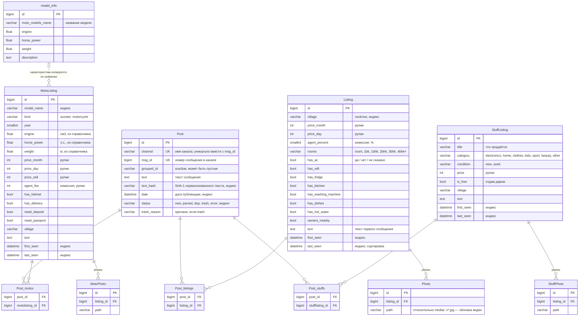

# Модель данных (ER)

> Источники: `ads/models.py`, `moto/models.py`, `stuff/models.py`; связи разделов — таблица `SECTIONS`
> в `services/ads/service.py`. СУБД — SQLite ([ADR-0001](adr/0001-sqlite.md)).

## Идея модели

- **`Post`** — сырое сообщение из Telegram, общее для всех разделов. Что это за объявление, решает LLM уже после сохранения.
- **Объявления** — результат разбора, по таблице на раздел: `Listing` (жильё), `MotoListing` (байки),
  `StuffListing` (барахолка). Поля разделов слишком разные, чтобы хранить их в одной таблице.
- **Сообщение ↔ объявление — многие-ко-многим.** Одно объявление собирается из нескольких сообщений
  (дубли в разных каналах), а одно сообщение-прайс-лист («Fascino 7000, Aerox 14000») даёт несколько объявлений.
  Связь один-к-одному теряла бы либо данные, либо плодила дубли карточек.
- **Фото принадлежат объявлению**, хранится только путь к файлу. У позиций одного прайс-листа общие фото.
- **`model_info`** — справочник характеристик байков. Связи по ключу нет: при создании `MotoListing`
  объём, мощность и вес *копируются* из справочника по похожему названию модели.

## Диаграмма

Промежуточные таблицы многие-ко-многим Django создаёт сам; на диаграмме они показаны явно.

## Таблицы

| Таблица | Приложение | Назначение | Ключевые ограничения |
|---|---|---|---|
| `Post` | `ads` | Сырые сообщения всех каналов | Уникальность (`channel`, `msg_id`) — повторный сбор не создаёт копий |
| `Listing` | `ads` | Объявления о жилье | Цены — неотрицательные целые, ₹ |
| `MotoListing` | `moto` | Объявления о байках (аренда и продажа) | `kind` — из списка |
| `StuffListing` | `stuff` | Вещи на барахолке | `category` по умолчанию `other` |
| `Photo`, `MotoPhoto`, `StuffPhoto` | по разделам | Пути к фото | Удаляются вместе с объявлением (CASCADE) |
| `model_info` | `moto` | Справочник характеристик моделей байков | Наполнен заранее, сервис только читает его |

## Соответствие раздела и таблиц

Сервис выбирает таблицы по виду объявления, который вернул LLM (`SECTIONS` в `service.py`):

| Вид (`kind`) | Объявление | Фото | Поле связи в `Post` | Папка фото |
|---|---|---|---|---|
| `rent` | `Listing` | `Photo` | `listings` | `media/photos/<id>/` |
| `bike` | `MotoListing` | `MotoPhoto` | `motos` | `media/photos/moto/<id>/` |
| `sale` | `StuffListing` | `StuffPhoto` | `stuffs` | `media/photos/stuff/<id>/` |

## Даты объявления

- `first_seen` — дата первого сообщения, из которого создано объявление.
- `last_seen` — дата самого свежего привязанного сообщения. Каждый дубль или склейка сдвигает её вперёд;
  по ней сайт фильтрует «за неделю / за месяц» и сортирует «сначала свежие».

## Архивные таблицы

`Filter_items`, `Tg_ads`, `AdsImage` (`ads`), `Filter_items_moto`, `Tg_moto` (`moto`), `Tg_stuff` (`stuff`) —
таблицы прежней версии, где каждый раздел собирался своими скриптами. Новым сервисом не используются,
оставлены как архив; на диаграмме не показаны.
