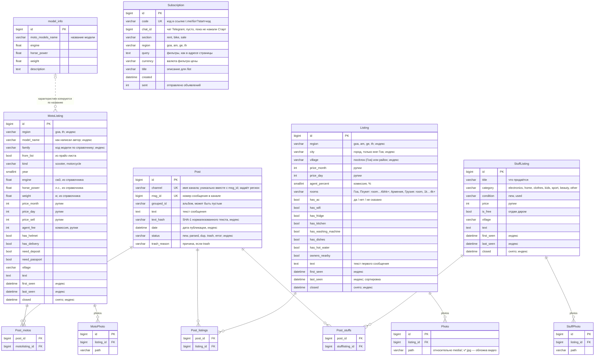

# Модель данных (ER)

> Источники: `ads/models.py`, `moto/models.py`, `stuff/models.py`, `moto/catalog.py`, `ads/places.py`;
> связи разделов — таблица `SECTIONS`, регионы — `EXTRA_REGIONS` в `services/ads/service.py`.
> СУБД — SQLite ([ADR-0001](adr/0001-sqlite.md)).

## Идея модели

- **`Post`** — сырое сообщение из Telegram, общее для всех разделов и регионов. Что это за объявление, решает LLM уже после сохранения.
- **Объявления** — результат разбора, по таблице на раздел: `Listing` (жильё), `MotoListing` (байки),
  `StuffListing` (барахолка). Поля разделов слишком разные, чтобы хранить их в одной таблице.
- **Регион — поле, а не отдельная база** ([ADR-0005](adr/0005-regions-as-config.md)): у `Listing` и `MotoListing`
  поле `region` (`goa`, `am`, `ge`, `th`). Барахолка пока только в Гоа — у `StuffListing` региона нет.
- **Место**: в Гоа — `village` (посёлок); вне Гоа — `city` (город) + `village` (район внутри города), районы и их синонимы —
  справочник в коде `ads/places.py`.
- **Сообщение ↔ объявление — многие-ко-многим.** Одно объявление собирается из нескольких сообщений
  (дубли в разных каналах — так собрано 46 % карточек жилья), а одно сообщение-прайс-лист («Fascino 7000, Aerox 14000»)
  даёт несколько объявлений. Связь один-к-одному теряла бы либо данные, либо плодила дубли карточек.
- **Снятые не удаляются**: поле `closed` (дата) скрывает объявление из списков ([ADR-0006](adr/0006-closed-listings.md)).
- **Фото принадлежат объявлению**, хранится только путь к файлу. У позиций одного прайс-листа общие фото.
- **Два справочника байков**: код модели (`family`) — по списку из 41 модели в коде (`moto/catalog.py`), для фильтра и картинки;
  `model_info` — таблица характеристик. Связи по ключу нет: объём, мощность и вес *копируются* при создании `MotoListing`.
- **`Subscription`** — подписка на поиск для бота: фильтры хранятся строкой, как в адресе страницы, и прогоняются
  через ту же функцию отбора, что у сайта.

## Диаграмма

Промежуточные таблицы многие-ко-многим Django создаёт сам; на диаграмме они показаны явно.

## Таблицы

| Таблица | Приложение | Назначение | Строк (19.10.2026) | Ключевые ограничения |
|---|---|---|---|---|
| `Post` | `ads` | Сырые сообщения всех каналов и регионов | 15 835 | Уникальность (`channel`, `msg_id`) — повторный сбор не создаёт копий |
| `Listing` | `ads` | Объявления о жилье, 4 региона | 3 200 | Цены — неотрицательные целые, ₹ |
| `MotoListing` | `moto` | Объявления о байках (аренда и продажа), Гоа и Пхукет | 200 | `kind` — из списка |
| `StuffListing` | `stuff` | Вещи на барахолке Гоа | 161 | `category` по умолчанию `other` |
| `Photo`, `MotoPhoto`, `StuffPhoto` | по разделам | Пути к фото | ~15 000 у жилья | Удаляются вместе с объявлением (CASCADE) |
| `model_info` | `moto` | Справочник характеристик моделей байков | — | Наполнен заранее, сервис только читает его |
| `Subscription` | `ads` | Подписки на поиск в боте | единицы | `code` уникален; не больше 10 подписок на чат |

## Соответствие раздела и таблиц

Сервис выбирает таблицы по виду объявления, который вернул LLM (`SECTIONS` в `service.py`):

| Вид (`kind`) | Объявление | Фото | Поле связи в `Post` | Папка фото | Регионы |
|---|---|---|---|---|---|
| `rent` | `Listing` | `Photo` | `listings` | `media/photos/<id>/` | Гоа, Армения, Грузия, Пхукет |
| `bike` | `MotoListing` | `MotoPhoto` | `motos` | `media/photos/moto/<id>/` | Гоа, Пхукет |
| `sale` | `StuffListing` | `StuffPhoto` | `stuffs` | `media/photos/stuff/<id>/` | Гоа |

## Даты объявления

- `first_seen` — дата первого сообщения, из которого создано объявление. При догрузке истории может сдвинуться назад,
  если нашлось более раннее сообщение.
- `last_seen` — дата самого свежего привязанного сообщения. Каждый дубль или склейка сдвигает её вперёд и снимает
  пометку `closed`; по ней сайт фильтрует «за неделю / за месяц» и сортирует «сначала свежие».
- `closed` — когда сборщик заметил, что объявление сдано, продано или удалено.

## Что хранится не в базе

| Данные | Где | Почему |
|---|---|---|
| Районы городов и синонимы | `ads/places.py` | Десятки строк, меняются вместе с подсказкой GPT |
| Коды моделей байков, шаблоны названий, марки машин | `moto/catalog.py` | То же; картинки моделей — `static/vendor/img/bikes/<код>.jpg` |
| Списки каналов | `services/*/parser/tg_urls*.py` | Правятся вручную, видны в истории git |
| «Просмотрено» | `localStorage` браузера | Входа нет — привязать к пользователю нельзя |
| Выбранная валюта | cookie `currency_<регион>` | То же |
| Курсы валют | кэш Django, 6 часов | Внешние данные, перезапрашиваются |

## Архивные таблицы

`Filter_items`, `Tg_ads`, `AdsImage` (`ads`), `Filter_items_moto`, `Tg_moto` (`moto`), `Tg_stuff` (`stuff`) —
таблицы прежней версии, где каждый раздел собирался своими скриптами. Новым сервисом не используются,
оставлены как архив; на диаграмме не показаны.
