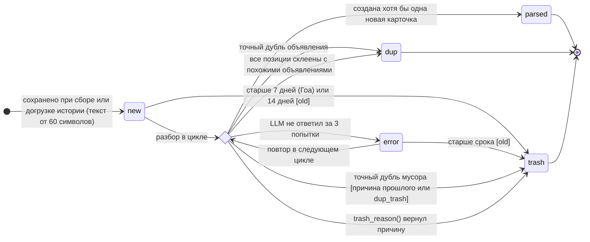

# Состояния сообщения (`Post.status`)

> Источники: `ads/models.py` (`Post.STATUSES`), `services/ads/service.py` (`collect`, `process_new`,
> `attach`, `trash_reason`), `moto/catalog.py` (`is_car`).

У сообщения пять состояний: `new` (новое), `parsed` (разобрано), `dup` (дубль), `trash` (мусор), `error` (ошибка).
`parsed`, `dup` и `trash` — конечные: такие сообщения больше не обрабатываются.

За неделю 12–18.10.2026 из 8 062 сообщений: `parsed` — 21 %, `dup` — 33 %, `trash` — 42 %, ждали разбора — 4 %
([проект в цифрах](06-metrics.md)).

## Переходы

| Из | В | Условие | Что ещё происходит |
|---|---|---|---|
| — | `new` | Сообщение (или альбом) новое для канала, текст ≥ 60 символов | Считается `text_hash` |
| `new`, `error` | `trash` (`old`) | Сообщение старше срока актуальности на момент разбора: Гоа — 7 дней, Армения, Грузия, Пхукет — 14 | В LLM не отправляется |
| `new`, `error` | `dup` | Найдено сообщение с тем же `text_hash` за 30 дней, у него есть объявления | Привязка к тем же объявлениям, `last_seen` сдвигается |
| `new`, `error` | `trash` | Точный дубль сообщения, которое объявлений не дало | Причина копируется у прошлого, иначе `dup_trash` |
| `new`, `error` | `error` | LLM не вернул ответ за 3 попытки | Повтор в следующем цикле |
| `new`, `error` | `trash` | `trash_reason()` вернул причину (таблица ниже) | — |
| `new`, `error` | `parsed` | Создана хотя бы одна новая карточка | Скачиваются фото, подписчикам бота уходит уведомление |
| `new`, `error` | `dup` | Годное объявление, но каждая позиция склеилась с существующим похожим | Привязка, `last_seen` сдвигается, пометка «снято» снимается |

Состояние объявления «снято» (`closed`) — отдельное поле у `Listing`, `MotoListing`, `StuffListing`, а не статус
сообщения: см. [ADR-0006](adr/0006-closed-listings.md).

## Причины мусора (`trash_reason`)

Число — сколько сообщений получили эту причину за неделю 12–18.10.2026.

| Причина | Когда | За неделю | Правило |
|---|---|---|---|
| `old` | Сообщение старше срока актуальности | 410 | `MAX_AGE_DAYS = 7`, `MAX_AGE_DAYS_EXTRA = 14` |
| `dup_trash` | Точный дубль сообщения, у которого не было объявлений и не записана причина | — | — |
| `other` | Болтовня, реклама, спам | 1 060 | Вид не из `rent`/`bike`/`sale` |
| `property_sale` | Продажа недвижимости или земли | 682 | то же |
| `exchange` | Обмен валют | 282 | то же |
| `work` | Работа | 236 | то же |
| `car` | Аренда или продажа машины — по виду от LLM или по названию модели из справочника машин | 235 | то же; `is_car()` |
| `service` | Услуги | 117 | то же |
| `visa` | Визы | 79 | то же |
| `seek` | Человек ищет жильё, а не сдаёт | 63 | то же |
| `<регион>_<вид>` | Раздела нет в регионе: `th_sale` (барахолка Пхукета), `am_bike`, `ge_sale`… | 31 (`th_sale`) | `EXTRA_REGIONS` |
| `no_price` | Жильё без цены за месяц и за сутки | 94 | — |
| `bike_no_price` | Байк без цены аренды и продажи | 6 | — |
| `sale_no_title` | Вещь без названия | — | — |
| `sale_no_price` | Вещь без цены и не «даром» | 2 | — |
| `rent_too_cheap` | Жильё дешевле 3 000 ₹/мес | 1 | `RENT_MIN_MONTH`, [ADR-0004](adr/0004-cheap-rent-to-trash.md) |
| `rent_cheap_no_rooms` | Жильё без указания комнат дешевле 10 000 ₹/мес | 5 | `RENT_MIN_MONTH_NO_ROOMS`, [ADR-0004](adr/0004-cheap-rent-to-trash.md) |
| `bike_list_same_price` | Реклама проката: 3+ модели с одной ценой «от X» | 43 | `FROM_PRICE` |
| `many_objects`, `bike_many`, `sale_many` | Прайс-лист жилья / байков / вещей, из которого не вышло ни одной годной позиции | 17 / 58 / — | — |

Проверки идут в этом порядке: вид → раздел есть в регионе → реклама проката → прайс-лист → поля раздела →
машина → цена → порог дешёвого жилья. Позиции прайс-листа проверяются теми же правилами по отдельности:
негодные отбрасываются, годные становятся карточками.

## Зачем хранить мусор, а не удалять

- **Повторы не стоят денег:** точный дубль мусорного сообщения узнаётся по хэшу и не уходит в LLM повторно.
- **Сбор не начинается заново:** номер последнего сообщения канала берётся из всех сохранённых, включая мусор.
- **Качество можно проверить:** по причинам видно, что отсекается, и можно найти ошибки разбора.
- **Это аналитика рынка:** например, 682 объявления о продаже недвижимости за неделю — сигнал для возможного нового раздела.
