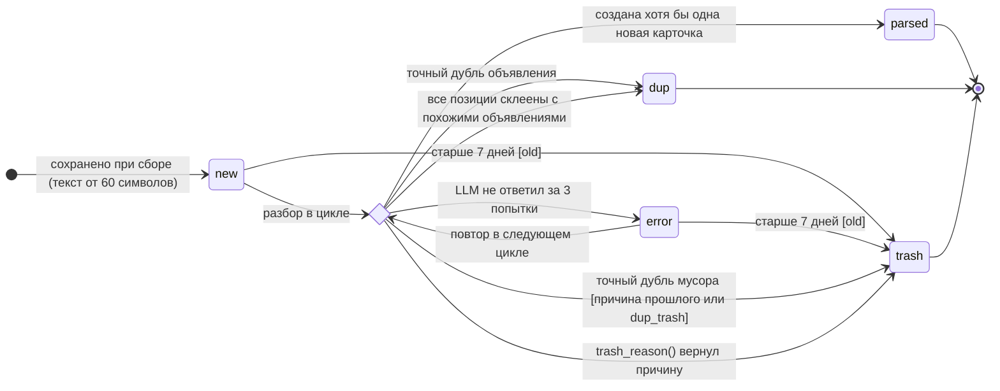

# Состояния сообщения (`Post.status`)

> Источники: `ads/models.py` (`Post.STATUSES`), `services/ads/service.py` (`collect`, `process_new`,
> `attach`, `trash_reason`).

У сообщения пять состояний: `new` (новое), `parsed` (разобрано), `dup` (дубль), `trash` (мусор), `error` (ошибка).
`parsed`, `dup` и `trash` — конечные: такие сообщения больше не обрабатываются.

## Переходы

| Из | В | Условие | Что ещё происходит |
|---|---|---|---|
| — | `new` | Сообщение (или альбом) новое для канала, текст ≥ 60 символов | Считается `text_hash` |
| `new`, `error` | `trash` (`old`) | Дата сообщения старше 7 дней на момент разбора | В LLM не отправляется |
| `new`, `error` | `dup` | Найдено сообщение с тем же `text_hash` за 30 дней, у него есть объявления | Привязка к тем же объявлениям, `last_seen` сдвигается |
| `new`, `error` | `trash` | Точный дубль сообщения, которое объявлений не дало | Причина копируется у прошлого, иначе `dup_trash` |
| `new`, `error` | `error` | LLM не вернул ответ за 3 попытки | Повтор в следующем цикле |
| `new`, `error` | `trash` | `trash_reason()` вернул причину (таблица ниже) | — |
| `new`, `error` | `parsed` | Создана хотя бы одна новая карточка | Скачиваются фото |
| `new`, `error` | `dup` | Годное объявление, но каждая позиция склеилась с существующим похожим | Привязка, `last_seen` сдвигается |

## Причины мусора (`trash_reason`)

| Причина | Когда | Правило |
|---|---|---|
| `old` | Сообщение старше 7 дней — неактуально | `MAX_AGE_DAYS = 7` |
| `dup_trash` | Точный дубль сообщения, у которого не было объявлений и не записана причина | — |
| `seek` | Человек ищет жильё, а не сдаёт | Вид не из `rent`/`bike`/`sale` |
| `car` | Аренда или продажа машины | то же |
| `property_sale` | Продажа недвижимости или земли | то же |
| `work`, `service`, `exchange`, `visa` | Работа, услуги, обмен валют, визы | то же |
| `other` | Болтовня, реклама, спам | то же |
| `no_price` | Жильё без цены за месяц и за сутки | — |
| `bike_no_price` | Байк без цены аренды и продажи | — |
| `sale_no_title` | Вещь без названия | — |
| `sale_no_price` | Вещь без цены и не «даром» | — |
| `rent_too_cheap` | Жильё дешевле 3 000 ₹/мес | `RENT_MIN_MONTH`, [ADR-0004](adr/0004-cheap-rent-to-trash.md) |
| `rent_cheap_no_rooms` | Жильё без указания комнат дешевле 10 000 ₹/мес | `RENT_MIN_MONTH_NO_ROOMS`, [ADR-0004](adr/0004-cheap-rent-to-trash.md) |
| `many_objects`, `bike_many`, `sale_many` | Прайс-лист жилья / байков / вещей, из которого не вышло ни одной годной позиции | — |

Проверки идут в этом порядке: вид → прайс-лист → поля раздела → цена → порог дешёвого жилья.
Позиции прайс-листа проверяются теми же правилами по отдельности: негодные отбрасываются, годные становятся карточками.

## Зачем хранить мусор, а не удалять

- **Повторы не стоят денег:** точный дубль мусорного сообщения узнаётся по хэшу и не уходит в LLM повторно.
- **Сбор не начинается заново:** номер последнего сообщения канала берётся из всех сохранённых, включая мусор.
- **Качество можно проверить:** по причинам видно, что отсекается, и можно найти ошибки разбора.
